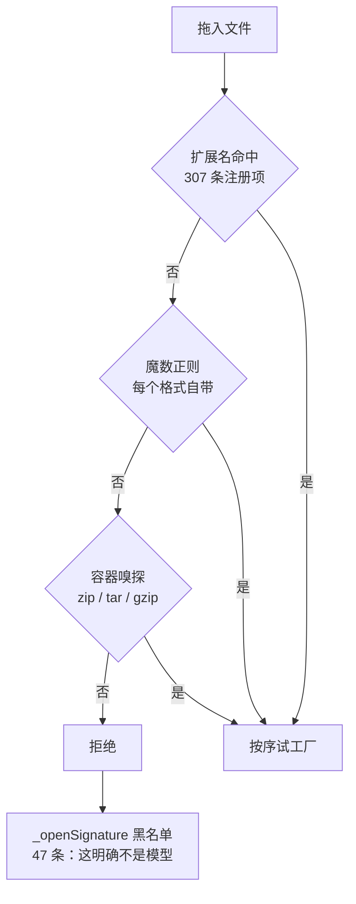

# Netron 是怎么在 28MB 代码里塞进 67 种模型格式的

Netron 9.3.2 支持 67 种模型格式。它自己的 JavaScript 代码只有 28MB。

这 28MB 里有 1.1MB 是一个**用 JavaScript 手写的 Python 解释器**——22,799 行，自带 tokenizer、parser、AST 和 `exec()`。

如果我用 Rust 重写它（正在做，`ai-model-viewer`），该抄什么、不该抄什么？读完这篇逆向拆解你会有答案。

下面每条结论都来自对 `/Applications/Netron.app` 的静态分析 + 解包 `app.asar` 后的源码通读，不是猜测。

> **版本说明**：分析途中 Netron 自动更新到了 9.3.2，本文所有数字均以 9.3.2 为准。9.3.1 → 9.3.2 只改了 12 个文件（`gguf.js`、`mlir.js`、`pytorch.js`、`python.js` 等），格式注册表、IPC 通道、黑名单、布局参数全部未变。

---

## 一、67 种格式不是靠扩展名认出来的，是靠 307 条扩展名加 47 条拒绝规则兜底的

Netron 的格式识别分三层，任何一层单独用都会误判：



关键在第一层为什么不够用。同一批扩展名被大量格式同时注册：

| 扩展名 | 同时注册它的格式数 |
|---|---|
| `.json` | 17 |
| `.bin` | 16 |
| `.model` | 16 |
| `.pb` | 12 |
| `.h5` | 6 |

`.pb` 同时属于 ONNX、TensorFlow、Caffe2、CoreML、TensorRT、UFF、PyTorch、TFLite、pickle、sklearn、om 等 12 个格式。`.model` 被 16 个格式认领，连 XGBoost 和 sentencepiece 都在里面。

所以扩展名只能用来**缩小候选集**，不能用来**定位解析器**。真正的仲裁靠每个格式自带的魔数正则：

```js
this.register('./onnx', [...], [], [
  /^\x08[\x00-\x10]\x12[\x00-\x20]\w\w/,
  /^\x08[\x00-\x10]\x12\x00\x1A/,
  /^\x08[\x00-\x10]\x3A/,
  /^\s*ir_version:\s\d+/
]);
this.register('./tflite', [...], [], [/^....TFL3/]);
this.register('./rknn', [...], [], [/^RKNN/, /^VPMN/]);
```

而第三层是兜底的救命设计：**如果文件本身是个容器**（zip / tar / gzip），先解容器，再在容器里找模型文件。PyTorch 的 `.zip` checkpoint、`.keras` 归档全走这条路。容器里如果找到多个模型文件，直接报错而不是随便挑一个。

第四层反过来——`_openSignature` 是一张**黑名单**，47 条记录，明确列出"这个东西不是模型"：

```js
{ name: 'PNG image', value: /^\x89PNG/ },
{ name: 'ELF executable', value: /^\x7FELF/ },
{ name: 'Bash script', value: /^(#!\/usr\/bin\/env|#!\/bin\/bash)\s/ },
{ name: 'SQLite data', value: /^SQLite format/ },
{ name: 'encrypted data', value: /^ENCRYPTED_FILE|EV_ENCRYPTED/ },
{ name: 'Windows executable', value: /^MZ[\s\S]*PE\x00\x00/ },
```

拖进一张 PNG，Netron 告诉你"文件内容是 PNG 图片"，而不是"不支持的格式"。这个差别决定了用户会不会觉得这软件有用。

> **抄**：识别必须是「扩展名缩小候选 → 魔数仲裁 → 容器下钻 → 黑名单兜底」四段式。特别别漏黑名单——它比多支持两个格式更影响体验。

---

## 二、大图布局被塞进 Worker，2.5 秒超时兜底，这是 Netron 对超大模型唯一的防御

Netron 遇到几千个算子的模型时，布局会卡住。它的做法不是优化算法，而是**把布局扔出主线程并放弃**。

`worker.js` 是个双模 worker：Node 环境用 `worker_threads.parentPort`，浏览器环境 `import('./dagre.js')` 拿 `self`。两边收同一条消息：

```js
case 'dagre.layout': {
    const dagre = await import('./dagre.js');
    dagre.layout(message.nodes, message.edges, message.layout, message.state);
    self.postMessage(message);
}
```

主线程这边（`grapher.js`）带 2500 毫秒超时，超了就抛一句人话：

```js
const message = await worker.request(
    { type: 'dagre.layout', nodes, edges, layout, state },
    2500,
    'This large graph layout might take a very long time to complete.'
);
```

布局参数是硬编码的：`nodesep: 20`、`ranksep: 20`、`rankdir: 'LR'`、`ranker: 'longest-path'`。方向固定左右，不可改。

这个"认输"策略值得学——但参数别抄。你的 `layout.rs` 用的是分层 + 居中 + `pull_floating_ops` 把只消费隐藏 initializer 的算子拉下来，方向和间距都能调，这块你已经比它强。

> **抄**：布局必须异步、必须有超时兜底、必须有能看懂的失败提示。**别抄**：dagre 和它那套固定参数。

---

## 三、IPC 只有 13 条渲染进程→主进程的通道，模型数据一次都没走过 IPC

方向是分开的：渲染进程→主进程 13 条（都在 `app.js` 的 `ipcMain.on`），主进程→渲染进程 15 条（都在 `desktop.mjs` 的 `ipcRenderer.on`）。

渲染进程→主进程这 13 条：

| 通道 | 干什么 |
|---|---|
| `execute` | 唯一的双向命令通道（配 `execute-complete` 回执） |
| `drop-paths` | 拖放文件 |
| `show-save-dialog` | 导出 PNG/SVG（配 `show-save-dialog-complete` 回执） |
| `get-configuration` / `set-configuration` / `delete-configuration` | 配置持久化 |
| `update-recents` | 最近文件列表 |
| `get-environment` | 读版本号等环境信息（`sendSync` 同步） |
| `window-close` / `window-minimize` / `window-toggle` / `window-update` / `update-window-state` | 窗口状态 |

**模型数据不走 IPC。** 拖进来的路径由主进程转交给视图，视图直接用 Node 的 `fs` 读文件、自己解析、自己画。`desktop.mjs` 里读文件还分了两档：

```js
if (stat && stat.size < 0x40000000) {          // < 1GB：整个读进内存
    fs.readFile(pathname, encoding, (err, data) => { ... });
} else {                                        // ≥ 1GB：走流
    const stream = new node.FileStream(pathname, 0, stat.size, stat.mtimeMs);
    resolve(stream);
}
```

1GB 是硬阈值，超过就换流式读取，避免把大模型整个塞进内存。

`execute` 是个命令分发器，主进程侧认这些命令：

```js
async execute(command, value, window) {
    switch (command) {
        case 'open': this._open(value); break;
        case 'export': await this._export(); break;
        case 'close': window.close(); break;
        case 'quit': electron.app.quit(); break;
        case 'reload': this._reload(); break;
        case 'report-issue': electron.shell.openExternal(...); break;
        case 'about': this._about(); break;
        default: {
            const view = this._views.get(window) || this._views.activeView;
            if (view && view.get(`${command}.enabled`) !== false) {
                view.execute(command, value || {});
            }
        }
    }
}
```

值得单独提的是它的 `webPreferences`：

```js
webPreferences: {
    preload: path.join(dirname, 'desktop.mjs'),
    contextIsolation: true,
    nodeIntegration: true,
    enableDeprecatedPaste: true
}
```

`contextIsolation: true` 和 `nodeIntegration: true` 同时开，在 Electron 里是罕见的危险组合——隔离了 preload 的上下文，却把 Node 能力直接给了页面。它靠两道防线兜住：`desktop.mjs` 里把 `window.eval` 和 `global.eval` 全部改成抛异常，`setWindowOpenHandler` 把所有新窗口请求 deny 掉、只把 http/https 交给系统浏览器。

> **不抄**：`nodeIntegration: true`。你用 Rust + WKWebView，没有这个负担，模型解析应该走原生侧，页面只收渲染好的 JSON。
>
> **抄**：1GB 阈值切流式读取这种量级意识。

---

## 四、真正的资产是 22,799 行手写 Python 解释器，而它是最不该抄的部分

Netron 支持的一批格式，上游生态是 Python：`keras`、`pytorch`、`tf`、`xgboost`、`lightgbm`、`catboost`、`flax`、`numpy`、`paddle`、`executorch`——**10 个格式模块**依赖 `python.js`。

它怎么解决"用户机器上没装 Python"这个问题？自己写一个。

`python.js` 不是 Python 绑定的胶水，是完整的解释器：`_Tokenizer` 分词、`_parseStatement` 递归下降、`ast.parse` 建 AST、`exec(code, context)` 执行。上面还重实现了 43 个 Python 模块，其中第三方生态占大头：

```
numpy  pandas  sklearn  torch  torchvision  torchao  keras  jax  xgboost
lightgbm  catboost  sympy  shap  ray  cuml  ultralytics  fastai  gensim
executorch  joblib  cloudpickle  pickle  pathlib  argparse  ast  builtins ...
```

`keras.js` 打开一个模型时会调 `execution.invoke('keras.models.load_model', ...)`；`xgboost.js` 调 `xgboost.core.Booster`。**真的在跑 Python 代码**，只是跑在一个 JS 实现的解释器里。

代价：1.1MB 源码（占 Netron 自家代码的 4%），22,799 行需要维护的解释器。
收益：用户零依赖，一个 509MB 的安装包就能读 `.pkl` 和 `.keras`。

这是整个逆向里最反直觉的一笔。**它不该被抄进 Rust 版**——Rust 重写一个 Python 解释器是不理智的。你的选择只有两个：要么这些格式标为"需外部 Python"，要么直接不接。

> **不抄**：手写 Python 解释器。**抄它的判断**：哪些格式值得为它单开一条外部依赖路径。

---

## 五、解析器工作量差 20 倍，真正的分水岭是上游生态用不用 protobuf

各格式模块的实际代码量：

| 模块 | 行数 | 形态 |
|---|---|---|
| `onnx.js` | 2917 | protobuf |
| `pytorch.js` | 2812 | zip + pickle + torchscript |
| `keras.js` | 1502 | HDF5 / json |
| `gguf.js` | 1431 | 自定义二进制 |
| `tflite.js` | 558 | flatbuffers |
| `weka.js` | 252 | Java 序列化 |
| `safetensors.js` | 239 | JSON 头 |
| `xgboost.js` | 156 | json / ubf |

差了 18 倍。规律很清楚：**上游生态用 protobuf / flatbuffers 的格式，解析器就短；用 Python pickle 或自造序列化的，就长**。

`onnx.js` 和 `pytorch.js` 之所以大，不是因为 ONNX 难，是因为它们各自扛了完整 protobuf schema（`onnx-proto.js`、`caffe-proto.js`、`coreml-proto.js` 等 36 个 schema 文件合计 3.2MB）加上格式各自的边角逻辑。

反过来，`safetensors.js` 只有 239 行——JSON 头 + 张量目录，没有 schema 要解。你已经接的 safetensors、GGUF 都在"短"这一侧，接得对。

选格式支持优先级时，先看上游生态用不用 protobuf。这条经验比任何"哪些格式更常用"的猜测都准。

> **抄**：这个排序经验。优先 protobuf/flatbuffers 生态的格式，性价比最高。

---

## 六、509MB 的安装包里只有 28MB 是 Netron

体积账：

| 组成 | 体积 | 说明 |
|---|---|---|
| `Electron Framework.framework` | 457MB | Electron 运行时 |
| `LICENSES.chromium.html` | 19MB | Chromium 许可证全文 |
| `app.asar` | 29MB | Netron 全部代码 |
| `Contents/Resources/app.asar/source` | 28MB | 179 个源文件 |

**90% 的安装包是 Electron。** Netron 自己的 179 个文件里，`view.js` 一个文件 8034 行，`base.js` 1494 行，`app.js` 1108 行，`python.js` 22778 行。

这一条基本决定了你为什么该用 Rust 重写：你的 `ai-model-viewer` 整个二进制目前没有 Electron 依赖，`dist/AI Model Viewer.app` 里只有你写的 Rust 代码和一个系统 WKWebView。509MB → 几 MB，差距不在优化，在架构选择。

> **抄**：这个结论。**不抄**：Electron 本身。

---

## 回顾

1. **格式识别是四段式**：扩展名缩候选 → 魔数仲裁 → 容器下钻 → 黑名单兜底。黑名单最影响体验。
2. **布局异步 + 超时 + 人话提示**，参数别抄 dagre 的。
3. **IPC 极薄**，模型数据不走 IPC；`nodeIntegration: true` 是不该学的错误。
4. **手写 Python 解释器**是最不該抄的一笔，但暴露了"哪些格式必须依赖外部运行时"这个真问题。
5. **protobuf 生态的格式最省力**， safetensors / GGUF / TFLite 属于这一类。
6. **90% 的体积是 Electron**，这是 Rust 重写的全部理由。

## 接下来：ai-model-viewer 的待办

按上面的结论，你这边有三件事可做：

- **识别链补齐黑名单**。你目前是 `looks_like_*` 系列函数按序嗅探（`onnx.rs:111-134`），已有魔数仲裁，但缺"这明确不是模型"的一层。加一个 `_looks_like_unsupported` 就能把"不支持的格式"变成"这是 PNG 图片"。
- **容器下钻层**。`.keras` 和 PyTorch zip 你已经处理了，但通用的 tar / gzip 嗅探还没有。`.tar.gz` 的模型文件在真实场景里不少见。
- **布局超时**。你的 `layout.rs` 是同步算的，大模型上会卡。Rust 侧改成后台线程 + 超时是自然的，WebView 那边等结果。

## 延伸

下一篇打算写 `.safetensors` 和 `.gguf` 两个格式的具体解析过程——这两个是你已经接的、也是最短的那类，把它们讲透比讲 67 种更有用。

---

**证据与复现**

- 目标：`/Applications/Netron.app` **9.3.2**，目录 sha256 `013c98310baaaa9e485eb760aeae6d3abb06b824156d73e1167bab61c79b6547`
- REA 静态分析（170 工具，MCP server）→ `evidence/netron-9.3.2-analyze-javascript-application.json`，60MB，evidence_id `ev_69688d52…`
- 源码级证据来自解包后的 `app.asar/source/*.js`（179 个文件），本文引用的代码片段均可在其中定位
- 复现：`scripts/analyze.sh`；摘要：`scripts/summarize.py`

**边界**：全部结论基于静态分析。行数、字节数、注册表条数是可复核的计数；"为什么这么设计"部分属于我从代码结构反推的判断，不是作者的说明。
